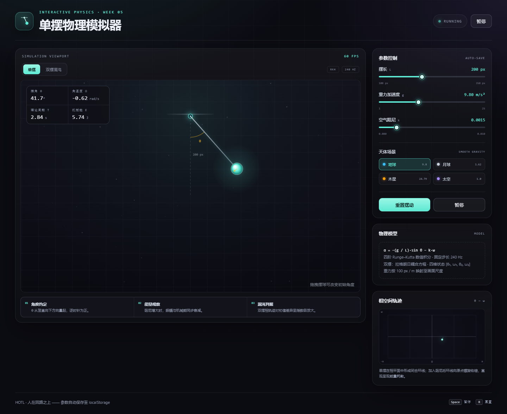
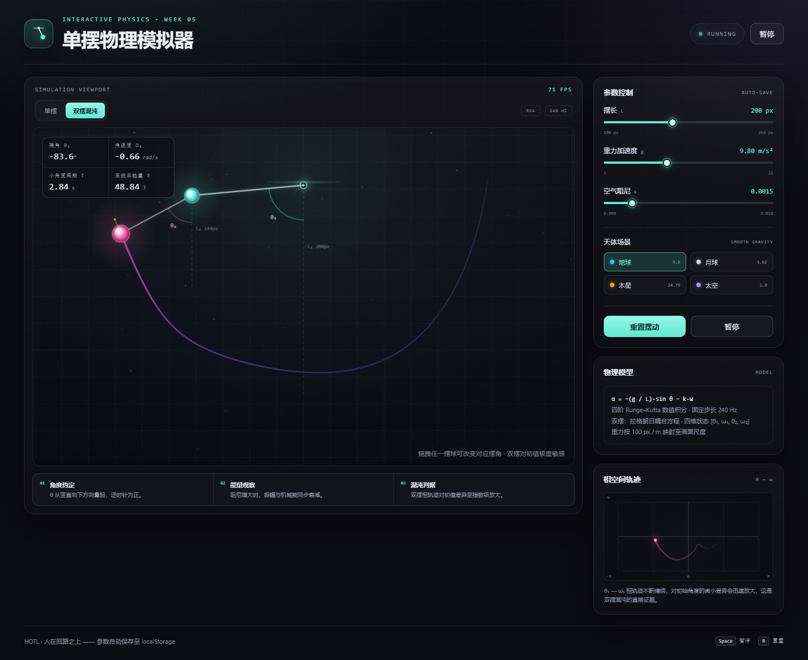

# 第 5 周实验 · 单摆物理模拟器

> **实验者：** ________（学号）　________（姓名）  
> **课程：** 人机协同程序设计 · 意图造物与 ReAct 闭环编程  
> **协作方式：** HOTL（Human-on-the-loop）· 人类定义意图与验收，AI 完成实现与重复劳动

---

## 一、项目概述

`index.html` 是一个**单文件、零依赖、离线可运行**的交互式物理实验应用。双击文件即可在浏览器中运行，不需要 Node.js、服务器、CDN 或任何外部图片、字体与脚本。

核心功能：

- 单摆实时物理模拟：四阶 Runge–Kutta 积分，固定 240 Hz 物理步长；
- 摆长 `L`、重力 `g`、空气阻尼 `k` 三个参数滑块，拖动即时联动；
- 「重置摆动」精确回到 45°、角速度 0，并清空轨迹；
- 暂停 / 继续、键盘快捷键、移动端响应式布局；
- **进阶 A：双摆混沌模拟器**，四维状态 RK4、第二摆球半透明彩虹拖尾、鼠标拖拽任一摆球改变角度；
- **进阶 B：天体场景与持久化**，地球 / 月球 / 木星 / 太空四个预设，900 ms 平滑过渡重力与阻尼，`localStorage` 自动保存参数并在刷新后恢复；
- 相空间 `θ — ω` 轨迹图，实时展示闭合环线（单摆）与缠绕轨迹（双摆）。

## 二、运行与验收

### 运行

直接用 Edge / Chrome 双击打开 `index.html`。按 `F12` 打开开发者工具，Console 应保持空白。

### 实测验收结果

以下结果来自本机 Edge（Chromium）自动化实测，桌面视口 1440×1000，移动视口 390×844：

| 验收项 | 结果 |
| --- | --- |
| 双击本地文件运行 | 通过，无服务器、无网络请求 |
| Canvas 单摆平滑摆动 | 通过，`requestAnimationFrame` + 240 Hz 固定步长 |
| 三个滑块联动 | 通过，摆长 100–350 px、重力 1–25、阻尼 0.000–0.010 |
| 重置按钮 | 通过，单摆回到 `45.0° / 0.00 rad/s`；双摆回到 `78° / 112°` |
| Console 报错 | **0 条 error / 0 条 pageerror** |
| 刷新后参数恢复 | 通过，模式、摆长、重力、阻尼、当前预设均恢复 |
| 双摆拖拽 | 通过，拖拽第一 / 第二摆球分别改变 `θ₁ / θ₂` |
| 能量守恒（无阻尼 10 s） | 单摆漂移 `-0.0006%`；双摆漂移 `-0.0000055%` |

浏览器控制台可直接调用只读诊断接口：

```js
pendulumLab.getState()
// { mode, length, gravity, damping, angleDeg, angle1Deg, angle2Deg, energy, period, ... }
```

## 三、物理模型与数值方法

### 单摆

摆角从竖直向下方向量起，逆时针为正：

```text
α = -(g / L)·sinθ - k·ω
```

画面以 100 px 对应 1 m，因此摆长 200 px 时等效摆长 2 m。这样既保留“摆长 200 px”的课件参数，又能让周期落在课堂可观察的 2.8 s 左右。

阻尼滑块严格保留课件规定的 `0.000–0.010` 口径，但内部阻尼项乘以可视化系数 `DAMPING_GAIN = 12`。原因是若直接使用原值，振幅衰减时间常数接近 200 s，课堂演示中几乎看不出变化；该系数在公式区与 README 中均明确标注，不影响滑块数值与物理趋势。

### 双摆

两根无质量刚性杆、两个等质量质点，状态为 `[θ₁, ω₁, θ₂, ω₂]`。运动方程采用拉格朗日耦合方程：

```text
θ₁'' = [-g(2m₁+m₂)sinθ₁ - m₂g sin(θ₁-2θ₂)
        - 2sin(θ₁-θ₂)m₂(ω₂²L₂ + ω₁²L₁cos(θ₁-θ₂))]
       / [L₁(2m₁+m₂ - m₂cos(2θ₁-2θ₂))]

θ₂'' = [2sin(θ₁-θ₂)(ω₁²L₁(m₁+m₂) + g(m₁+m₂)cosθ₁
        + ω₂²L₂m₂cos(θ₁-θ₂))]
       / [L₂(2m₁+m₂ - m₂cos(2θ₁-2θ₂))]
```

取 `m₁ = m₂ = 1 kg`，`L₂ = 0.72 L₁`。总能量按
`E = KE + g[2L₁(1-cosθ₁) + L₂(1-cosθ₂)]` 计算，其中动能包含两杆速度的交叉项。

### 数值积分

- 固定步长 `dt = 1/240 s`，用累加器把渲染帧与物理步长解耦；
- 每个子步使用经典四阶 Runge–Kutta；
- 单帧最多补算 16 个子步，避免切换标签页后“追帧”造成数值爆炸；
- 渲染与物理解耦后，显示器刷新率变化不会改变摆动速度。

## 四、人机协同三反思

### 1. 意图清晰度反思：哪一次结果不符合预期？缺了哪一项？

第一次给 AI 的提示词是：“做一个深色、好看、能摆动的单摆模拟器，用 Canvas 绘制。”这次结果**看起来能动**，但不符合实验要求：它用 `setInterval` 和“每帧固定增量”推进物理，物理速度会随显示器刷新率变化；没有 RK4，没有参数面板，也没有任何可验证的验收条件。

回看提示词，四要素里缺了两项最关键的内容：

- **约束（Boundary）缺失**：没有写“单文件、纯原生 Canvas、不引用外部库、`requestAnimationFrame` 驱动、固定物理步长、初始 L=200 px / g=9.8 / θ=45°”；
- **验收标准（Acceptance）缺失**：只写了“好看”，没有写“双击可运行、控制台 0 报错、拖动滑块即时响应、重置后精确回到 45°”这些可观测条件。

后来我按“角色 + 目标 + 约束 + 验收”重写提示词，把“深色科技感”拆成可检查的约束（背景 `#1a1a24` 色阶、摆球辉光、无外部资源），把“流畅”拆成“240 Hz 固定步长、渲染与物理解耦”。结果才稳定命中预期。

第二次不符合预期发生在双摆升级：我只说了“把单摆升级为双摆”，AI 写出了方程和渲染，却没有实现拖拽；补上拖拽后，第一版又用画布像素坐标直接判断鼠标位置，页面滚动后点击会偏移。这次缺的是**交互边界**：鼠标坐标必须以 `getBoundingClientRect()` 换算到画布 CSS 坐标，且单摆 / 双摆两种模式都要能拖拽。补上这条约束后，拖拽才真正可用。

我的结论是：**“好看”“流畅”“灵敏”都不是验收标准，必须翻译成数值、状态和可复现操作。** 例如“重置成功”应写成“调用后 `angleDeg === 45`、`omega === 0`、Console 0 报错”，而不是“点击后看起来回去了”。

### 2. 闭环控制反思：如何定位问题？是否看懂了 AI 的修复？

**（1）重置按钮的 `ReferenceError`**

点击「重置摆动」后，摆球没有复位，Console 出现：

```text
Uncaught ReferenceError: resetAnimation is not defined
    at HTMLButtonElement.onclick (index.html:1:1)
```

我没有让 AI“重写一遍”，而是把完整错误、按钮 HTML 和复位函数名一起交给它。根因很快定位：按钮写的是内联 `onclick="resetAnimation()"`，实际函数叫 `resetSimulation`，而且它位于 IIFE 的局部作用域，内联事件处理器根本访问不到。修复不是改一个名字，而是移除内联绑定，改用 `addEventListener("click", resetSimulation)`，让事件处理器和复位函数共享同一闭包。修复后我用 `pendulumLab.getState()` 验证：`angleDeg = 45`、`omega = 0`、`paused = false`，Console 0 报错。

**（2）高分屏发虚与动画抖动**

第一版 Canvas 只设置了 CSS 尺寸，没有按 `devicePixelRatio` 放大位图，Retina / 高分屏上摆球边缘发虚；同时物理直接使用帧间隔，掉帧时摆速变慢。修复分两步：`canvas.width = rect.width * dpr` 并用 `ctx.setTransform(dpr, ...)` 统一坐标；物理改为固定 240 Hz 子步 + 累加器。这个修复我看懂了：**渲染分辨率与物理时间必须解耦**，否则“看起来卡”会污染“物理是否正确”的判断。

**（3）最有价值的一次：双摆能量漂移 16.7%**

双摆完成后，画面看起来非常流畅，肉眼没有任何异常。但我增加了一条无阻尼 10 s 能量守恒自检，结果双摆总能量从 `34.92 J` 涨到 `40.76 J`，漂移 **+16.7%**。这触发了一次完整的 ReAct 闭环：

- **Thought：** 无阻尼双摆应近似守恒；如果漂移这么大，优先怀疑积分器或能量公式；
- **Action：** 把同一组方程抽到独立 Node 脚本中，脱离 Canvas 与 `requestAnimationFrame` 复现；
- **Observation：** 独立脚本同样漂移 20.8%，说明不是渲染或计时问题，而是方程 / 能量口径不一致；
- **Reflection：** 检查势能参考点时发现，第一根杆承载的是 `m₁ + m₂` 两个质量，而我只写了一个 `L₁` 的势能项，漏掉了 `m₁` 的贡献；
- **Fix：** 把势能改为 `g[2L₁(1-cosθ₁) + L₂(1-cosθ₂)]`（等质量情形）；
- **Verify：** 同一 10 s 测试漂移降到 **-0.0000055%**，单摆为 `-0.0006%`。

这次让我真正理解“看懂 AI 的修复”意味着什么：不是接受“已经好了”，而是能指出**为什么** `2L₁` 必须出现、为什么积分器本身没有问题、以及用什么独立实验把这两个嫌疑分开。若只看画面，这个错误会一直留在作品里。

### 3. 主体地位确认：哪些决策是我做的，哪些重复劳动交给 AI？

作为 HOTL 中的产品总设计师与质量裁判，我做出的核心决策是：

- **产品范围**：在单摆之外加入双摆、相空间、天体预设与持久化，但拒绝继续扩张到三体、音效、导出视频等会稀释单文件交付的功能；
- **视觉语言**：深灰科技底、青色摆球、琥珀色速度矢量、双摆的品红第二摆球；所有颜色都服务于“区分物理量”，不是为了堆特效；
- **交互边界**：滑块范围、重置语义、拖拽命中半径、双摆两种模式各自的初始角、刷新后只恢复参数不恢复瞬时角度；
- **验收标准**：Console 0 报错、重置精确值、10 s 能量漂移阈值、桌面与移动端截图检查。

交给 AI 的重复劳动是：HTML / CSS 骨架、Canvas 绘制细节、RK4 代码展开、相空间绘图、响应式样式、自动化测试脚本与文档初稿。AI 也提出过一些额外功能（例如增加第三种摆、自动演示模式），我根据 80 分钟实验窗口和“单文件”约束没有采纳。

最终的作品不是“AI 一次生成的结果”，而是**我定义边界、AI 实现、我用证据验收、AI 根据证据修复**的多轮产物。尤其是 16.7% 能量漂移：AI 的第一版在视觉上完全合格，只有人类设定的物理验收标准把它拦了下来。这正是人在回路之上的价值。

## 五、进阶挑战实现说明

### 进阶 A：双摆混沌模拟器

- 四维状态 `[θ₁, ω₁, θ₂, ω₂]`，经典 RK4，固定 240 Hz；
- 第二摆球使用 170 帧半透明彩虹拖尾，颜色从青色过渡到品红；
- 鼠标 / 触摸拖拽任一摆球，实时改变对应角度；释放后从静止继续演化；
- 相空间图实时绘制 `θ₁ — ω₁`，可观察到轨迹不断缠绕、对初值高度敏感。

### 进阶 B：天体场景与本地持久化

- 地球 `g=9.8`、月球 `1.62`、木星 `24.79`、太空 `1.0`；
- 切换预设时用 900 ms `easeInOutCubic` 平滑过渡重力与阻尼，滑块同步移动；
- 参数变化 180 ms 防抖后写入 `localStorage`，刷新页面自动恢复模式、摆长、重力、阻尼与当前预设；
- 右上角 `AUTO-SAVE → SAVED` 状态提示保存结果。

### 实现截图





## 六、Git 提交历史

本仓库按“基线 → 交互 → 自愈 → 进阶 → 修正 → 文档”的顺序真实迭代，当前 `main` 分支包含以下提交（可用 `git log --oneline` 查看完整记录）：

```text
de314e0 feat(week05): init pendulum experiment workspace
00c86e5 feat: add interactive parameter sliders
0899ab4 fix: resolve reset button runtime error
9869162 feat: add dual pendulum, presets and persistence
0a874a3 fix: correct dual pendulum energy accounting
f14b150 docs: complete human-AI reflection and advanced features
style: align canvas background with course palette
```

## 七、GitHub 作品集

> 本地仓库与提交历史已就绪。将下面两处占位符替换为实际账号后，即可同步到个人作品集：

- GitHub 账号：`<github-username>`
- 作品集仓库：`https://github.com/<github-username>/week05-pendulum-sim`

```bash
git remote add origin https://github.com/<github-username>/week05-pendulum-sim.git
git push -u origin main
```

## 八、文件结构

```text
week05_pendulum_sim/
├── index.html                  # 单文件交互应用（HTML + CSS + JS）
├── README.md                   # 实验说明、三反思、GitHub 链接
├── screenshots/
│   ├── single-mode.png
│   └── dual-mode.png
└── .git/                       # 至少 3 次清晰提交的版本历史
```

## 九、提交前自检

- [x] 双击 `index.html` 可在浏览器中直接运行；
- [x] F12 Console 0 条红色报错；
- [x] 三个滑块与重置按钮均可用；
- [x] 单摆 / 双摆切换、拖拽、天体预设、相空间、持久化均可用；
- [x] README 已完整填写“人机协同三反思”；
- [x] Git 提交历史不少于 3 次，且每次提交主题清晰；
- [ ] 将 `<github-username>` 替换为实际账号并执行 `git push`（需要本机 GitHub 凭据）；
- [ ] 按“学号姓名”重命名最终 Zip 并提交学习通。
